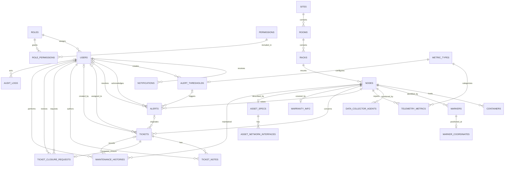

# ERD v1 và từ điển dữ liệu AR-IMMS

Phiên bản này mô tả schema SQL Server trong `database/02_create_tables.sql` và
snapshot bổ sung ở `database/08_telemetry_wide_node_latest_audit_v2.sql`.
Mô hình nền có 25 bảng, thêm hai bảng vận hành telemetry (`telemetry_wide`,
`node_latest`), gồm cây Digital Twin `Site → Room → Rack → Node → Container`,
RBAC, telemetry/cảnh báo, ticket bảo trì, tài sản và audit.

## ERD

`||` là đúng một, `o|` là không hoặc một, `o{` là không hoặc nhiều.
`ticket_closure_requests.ticket_id` là UNIQUE nên mỗi ticket có tối đa một yêu
cầu đóng. `warranty_info.node_id` và `asset_specs.node_id` cũng UNIQUE nên quan
hệ với Node là một-một tùy chọn.

## Nguyên tắc chuẩn hóa

- **1NF:** mỗi cột nghiệp vụ lưu một giá trị; các tập quyền, tọa độ và NIC được
  chuyển thành các dòng ở bảng quan hệ riêng, không nhét danh sách vào JSON.
- **2NF:** các bảng có khóa ghép (`role_permissions`,
  `asset_network_interfaces`) chỉ chứa thuộc tính phụ thuộc toàn bộ khóa ghép.
- **3NF:** thuộc tính mô tả một thực thể nằm tại bảng của thực thể đó; ví dụ đơn
  vị đo thuộc `metric_types`, không lặp trên từng mẫu telemetry; thông tin Site
  không lặp trong Room/Rack/Node mà được truy xuất qua khóa ngoại.
- Các cột trạng thái/loại dùng giá trị miền đơn và CHECK constraint; chúng không
  chứa danh sách giá trị.
- `audit_logs.username` là snapshot tên tại thời điểm ghi log, không dùng thay
  cho `users.username`. `audit_logs.details_json` là payload audit linh hoạt,
  không phải nguồn dữ liệu nghiệp vụ để join/báo cáo. Hai trường này được giữ
  có chủ đích nhằm bảo toàn bằng chứng lịch sử; các quan hệ nghiệp vụ còn lại
  được chuẩn hóa. Không cập nhật payload cũ khi người dùng đổi tên.

## Từ điển dữ liệu và lý do chuẩn hóa theo bảng

Ký hiệu: **PK** khóa chính, **FK** khóa ngoại, **UQ** duy nhất, **NN** NOT NULL.
Các cột thời gian có default dùng `SYSUTCDATETIME()` nếu không ghi chú khác.

### Người dùng và phân quyền

| Bảng | Cột (kiểu dữ liệu; ràng buộc) | Mục đích và chuẩn hóa |
|---|---|---|
| `roles` | `id` (`int`, PK, identity); `name` (`nvarchar(50)`, NN, UQ); `description` (`nvarchar(255)`, NULL) | Danh mục vai trò. Mỗi thuộc tính phụ thuộc vào khóa vai trò; quyền không còn là danh sách JSON. |
| `permissions` | `id` (`int`, PK, identity); `code` (`nvarchar(100)`, NN, UQ); `description` (`nvarchar(255)`, NULL) | Danh mục quyền độc lập để mô tả quyền một lần, dùng lại ở nhiều vai trò. |
| `role_permissions` | `role_id` (`int`, PK/FK → `roles.id`, NN); `permission_id` (`int`, PK/FK → `permissions.id`, NN) | Bảng nối biểu diễn quan hệ N-N. Khóa ghép ngăn gán trùng; không có thuộc tính phụ thuộc một phần khóa. |
| `users` | `id` (`int`, PK, identity); `username` (`nvarchar(50)`, NN, UQ); `email` (`nvarchar(100)`, NN, UQ); `password_hash` (`nvarchar(255)`, NN); `full_name` (`nvarchar(100)`, NN); `role_id` (`int`, FK → `roles.id`, NN); `is_active` (`bit`, NN, default 1); `created_at`, `updated_at` (`datetime2`, NN, UTC default) | Mỗi người dùng thuộc một vai trò. Thông tin vai trò không lặp trong user. |
| `notifications` | `id` (`int`, PK, identity); `user_id` (`int`, FK → `users.id`, NN); `title` (`nvarchar(150)`, NN); `message` (`nvarchar(max)`, NN); `type` (`nvarchar(50)`, NN, default `SYSTEM`); `is_read` (`bit`, NN, default 0); `created_at` (`datetime2`, NN, UTC default) | Mỗi thông báo là một dòng của một người nhận; không lưu danh sách thông báo trong User. |

### Digital Twin và collector

| Bảng | Cột (kiểu dữ liệu; ràng buộc) | Mục đích và chuẩn hóa |
|---|---|---|
| `sites` | `id` (`int`, PK, identity); `name` (`nvarchar(100)`, NN); `code` (`nvarchar(50)`, NN, UQ); `location` (`nvarchar(255)`, NULL); `description` (`nvarchar(max)`, NULL); `created_at`, `updated_at` (`datetime2`, NN, UTC default) | Thực thể Site độc lập. |
| `rooms` | `id` (`int`, PK, identity); `site_id` (`int`, FK → `sites.id`, NN); `name` (`nvarchar(100)`, NN); `code` (`nvarchar(50)`, NN, UQ); `floor` (`nvarchar(50)`, NULL); `description` (`nvarchar(max)`, NULL); `created_at`, `updated_at` (`datetime2`, NN, UTC default) | Phụ thuộc Site bằng FK; không sao chép tên/mã Site vào Room. |
| `racks` | `id` (`int`, PK, identity); `room_id` (`int`, FK → `rooms.id`, NN); `name` (`nvarchar(100)`, NN); `code` (`nvarchar(50)`, NN, UQ); `unit_capacity` (`int`, NN, default 42); `total_power_capacity_watts` (`float`, NN, default 5000); `created_at`, `updated_at` (`datetime2`, NN, UTC default) | Thuộc tính công suất/vị trí được lưu tại Rack, không lưu lặp tại Node. |
| `nodes` | `id` (`int`, PK, identity); `rack_id` (`int`, FK → `racks.id`, NN); `name`, `hostname` (`nvarchar(100)`, NN); `ip_address` (`nvarchar(50)`, NN); `mac_address` (`nvarchar(50)`, NULL); `status` (`nvarchar(20)`, NN, default `ONLINE`, CHECK); `rack_position_u` (`int`, NN, default 1); `power_consumption_watts` (`float`, NN, default 150); `last_ping_at` (`datetime2`, NULL, UTC default); `created_at`, `updated_at` (`datetime2`, NN, UTC default) | Node chỉ tham chiếu Rack; đường dẫn lên Room/Site được suy ra qua FK, tránh phụ thuộc bắc cầu do lặp khóa cấp trên. |
| `containers` | `id` (`int`, PK, identity); `node_id` (`int`, FK → `nodes.id`, NN); `container_id` (`nvarchar(100)`, NN); `name` (`nvarchar(100)`, NN); `image` (`nvarchar(255)`, NN); `status` (`nvarchar(20)`, NN, default `RUNNING`, CHECK); `cpu_usage_percent`, `memory_usage_mb` (`float`, NN, default 0); `restarted_count` (`int`, NN, default 0); `created_at`, `updated_at` (`datetime2`, NN, UTC default) | Mỗi container là một thực thể thuộc một Node. CPU/RAM hiện tại là snapshot; lịch sử container chưa thuộc phạm vi v1. |
| `markers` | `id` (`int`, PK, identity); `node_id` (`int`, FK → `nodes.id`, NN); `marker_type` (`nvarchar(20)`, NN, default `ARUCO`, CHECK); `marker_code` (`nvarchar(100)`, NN, UQ); `created_at`, `updated_at` (`datetime2`, NN, UTC default) | Danh tính marker tách khỏi tọa độ để marker không chứa thuộc tính tổng hợp. |
| `marker_coordinates` | `marker_id` (`int`, PK/FK → `markers.id`, NN); `x`, `y`, `z` (`float`, NULL; CHECK: cùng NULL hoặc cùng có giá trị) | Tối đa một vị trí cho marker. Ba trục là các thuộc tính riêng, không phải JSON/danh sách. |
| `data_collector_agents` | `id` (`int`, PK, identity); `node_id` (`int`, FK → `nodes.id`, NN); `agent_version` (`nvarchar(50)`, NN); `status` (`nvarchar(20)`, NN, default `ACTIVE`, CHECK); `api_key_hash` (`nvarchar(255)`, NULL); `last_heartbeat_at` (`datetime2`, NULL, UTC default); `created_at`, `updated_at` (`datetime2`, NN, UTC default) | Một Node có thể có nhiều bản ghi agent; mỗi hàng mô tả một agent, không lặp thông tin Node. |

### Telemetry và cảnh báo

| Bảng | Cột (kiểu dữ liệu; ràng buộc) | Mục đích và chuẩn hóa |
|---|---|---|
| `metric_types` | `id` (`int`, PK, identity); `code` (`nvarchar(50)`, NN, UQ); `unit` (`nvarchar(20)`, NULL); `description` (`nvarchar(255)`, NULL) | Từ điển loại số đo. Đơn vị phụ thuộc vào loại metric nên được lưu một lần tại đây. |
| `telemetry_metrics` | `id` (`bigint`, PK, identity); `node_id` (`int`, FK → `nodes.id`, NN); `metric_type_id` (`int`, FK → `metric_types.id`, NN); `value` (`float`, NN); `timestamp` (`datetime2`, NN, UTC default) | Mỗi hàng là một lần đo. Không lặp chuỗi loại/đơn vị; index hỗ trợ truy vấn theo Node/thời gian và loại/thời gian. |
| `telemetry_wide` | `telemetry_id` (`bigint`, PK, identity); `node_id` (`int`, FK → `nodes.id`, NN); `collected_at` (`datetime2(0)`, NN, UTC); các cột snapshot CPU/RAM/disk/nhiệt độ, network, uptime và process | Một hàng là snapshot rộng của một Node, tối ưu cho ingest/reporting; bảng metric chuẩn hóa bên trên vẫn giữ contract cũ. |
| `node_latest` | `node_id` (`int`, PK/FK → `nodes.id`, NN); `telemetry_id` (`bigint`, FK → `telemetry_wide.telemetry_id`, NN); `collected_at` và các cột snapshot tương ứng | Projection một hàng mới nhất cho mỗi Node, được cập nhật nguyên tử bởi `usp_record_telemetry_wide`. |
| `alert_thresholds` | `id` (`int`, PK, identity); `metric_type_id` (`int`, FK → `metric_types.id`, NN, UQ); `warning_threshold`, `critical_threshold` (`float`, NN); `duration_seconds` (`int`, NN, default 30); `is_active` (`bit`, NN, default 1); `created_by_user_id` (`int`, FK → `users.id`, NULL); `created_at`, `updated_at` (`datetime2`, NN, UTC default) | Mỗi loại metric có tối đa một cấu hình ngưỡng; đơn vị/mã metric không bị lặp lại. |
| `alerts` | `id` (`int`, PK, identity); `node_id` (`int`, FK → `nodes.id`, NN); `threshold_id` (`int`, FK → `alert_thresholds.id`, NULL); `alert_type` (`nvarchar(50)`, NN); `severity` (`nvarchar(20)`, NN, default `WARNING`, CHECK); `status` (`nvarchar(20)`, NN, default `OPEN`, CHECK); `message` (`nvarchar(max)`, NN); `metric_value` (`float`, NN, default 0); `triggered_at` (`datetime2`, NN, UTC default); `acknowledged_at`, `resolved_at` (`datetime2`, NULL); `acknowledged_by_user_id`, `resolved_by_user_id` (`int`, FK → `users.id`, NULL) | Một cảnh báo tham chiếu Node, ngưỡng và các User liên quan; chi tiết ngưỡng không được sao chép vào alert. |

### Ticket, tài sản, bảo trì và audit

| Bảng | Cột (kiểu dữ liệu; ràng buộc) | Mục đích và chuẩn hóa |
|---|---|---|
| `tickets` | `id` (`int`, PK, identity); `alert_id` (`int`, FK → `alerts.id`, NULL); `node_id` (`int`, FK → `nodes.id`, NN); `title` (`nvarchar(200)`, NN); `description` (`nvarchar(max)`, NN); `priority` (`nvarchar(20)`, NN, default `MEDIUM`, CHECK); `status` (`nvarchar(20)`, NN, default `OPEN`, CHECK); `assigned_to_user_id`, `created_by_user_id` (`int`, FK → `users.id`, NULL); `created_at`, `updated_at` (`datetime2`, NN, UTC default) | Ticket tham chiếu các thực thể liên quan bằng FK; tên Node/User không bị sao chép vào ticket. |
| `ticket_notes` | `id` (`int`, PK, identity); `ticket_id` (`int`, FK → `tickets.id`, NN); `author_user_id` (`int`, FK → `users.id`, NN); `note_text` (`nvarchar(max)`, NN); `created_at` (`datetime2`, NN, UTC default) | Một ghi chú mỗi hàng, tác giả và ticket được tham chiếu riêng. |
| `ticket_closure_requests` | `id` (`int`, PK, identity); `ticket_id` (`int`, FK → `tickets.id`, NN, UQ); `requested_by_user_id` (`int`, FK → `users.id`, NN); `summary` (`nvarchar(255)`, NN); `resolution_details` (`nvarchar(max)`, NN); `status` (`nvarchar(20)`, NN, default `PENDING`, CHECK); `reviewed_by_user_id` (`int`, FK → `users.id`, NULL); `reviewed_at` (`datetime2`, NULL); `created_at` (`datetime2`, NN, UTC default) | Yêu cầu đóng là thực thể riêng; UNIQUE ticket đảm bảo tối đa một yêu cầu hiện hành cho mỗi ticket. |
| `warranty_info` | `id` (`int`, PK, identity); `node_id` (`int`, FK → `nodes.id`, NN, UQ); `vendor`, `model_number`, `serial_number` (`nvarchar(100)`, NN); `purchase_date`, `warranty_start`, `warranty_end` (`datetime2`, NULL); `support_contact` (`nvarchar(255)`, NULL); `created_at`, `updated_at` (`datetime2`, NN, UTC default) | Thông tin bảo hành tách khỏi Node và có quan hệ 1-1; không lặp dữ liệu bảo hành theo từng sự kiện. |
| `asset_specs` | `id` (`int`, PK, identity); `node_id` (`int`, FK → `nodes.id`, NN, UQ); `cpu_model` (`nvarchar(100)`, NN); `cpu_cores` (`int`, NN); `total_ram_gb`, `total_storage_gb` (`float`, NN); `os_name` (`nvarchar(100)`, NN); `os_version` (`nvarchar(50)`, NN); `created_at`, `updated_at` (`datetime2`, NN, UTC default) | Thông số phần cứng/hệ điều hành tách khỏi Node; NIC được mô hình thành nhiều dòng riêng. |
| `asset_network_interfaces` | `asset_spec_id` (`int`, PK/FK → `asset_specs.id`, NN); `interface_name` (`nvarchar(100)`, PK, NN); `mac_address`, `ipv4_address`, `ipv6_address` (`nvarchar(50)`, NULL); `speed_mbps`, `mtu` (`int`, NULL); `is_up` (`bit`, NULL) | NIC là tập con nhiều dòng; khóa ghép nhận diện mỗi interface trong một bộ thông số và không có thuộc tính phụ thuộc một phần khóa. |
| `maintenance_histories` | `id` (`int`, PK, identity); `node_id` (`int`, FK → `nodes.id`, NN); `ticket_id` (`int`, FK → `tickets.id`, NULL); `maintenance_type` (`nvarchar(50)`, NN, default `PREVENTIVE`, CHECK); `description` (`nvarchar(max)`, NN); `performed_by_user_id` (`int`, FK → `users.id`, NN); `performed_at` (`datetime2`, NN, UTC default); `resolution_notes` (`nvarchar(max)`, NULL); `created_at` (`datetime2`, NN, UTC default) | Mỗi lần bảo trì là một sự kiện riêng; ticket và người thực hiện được tham chiếu bằng FK. |
| `audit_logs` | Các cột v1 giữ nguyên; v2 thêm `event_id` (`uniqueidentifier`, UQ), `event_type` (`nvarchar(100)`), `correlation_id` (`uniqueidentifier`, NULL), `created_at` (`datetime2(0)`, UTC) | Dòng log bất biến; metadata v2 hỗ trợ định danh sự kiện, phân loại và liên kết một luồng xử lý mà không thay đổi payload lịch sử. |

## Kiểm thử và chạy lại

1. Chạy `database/01_create_database.sql` đến `database/05_retention_policy.sql`.
2. Chạy lại nhóm script 01–05 lần nữa để kiểm tra tính lặp an toàn; bước 02 sẽ
   chuyển các cột cũ sang quan hệ mới trong transaction và không xóa dữ liệu nếu
   gặp JSON không ánh xạ được.
3. Chạy `database/06_verify_seed_data.sql`: kỳ vọng thông báo `PASS` và không
   có lỗi.
4. Chạy `database/07_test_normalized_schema.sql`: kỳ vọng ba thông báo `PASS`;
   số đo hợp lệ tạo cảnh báo, đơn vị sai bị từ chối và FK từ chối metric không tồn tại.

Kiểm thử đầy đủ yêu cầu SQL Server Developer/SQL Server 2016+ với compatibility
level 130 trở lên (hỗ trợ `OPENJSON`).
